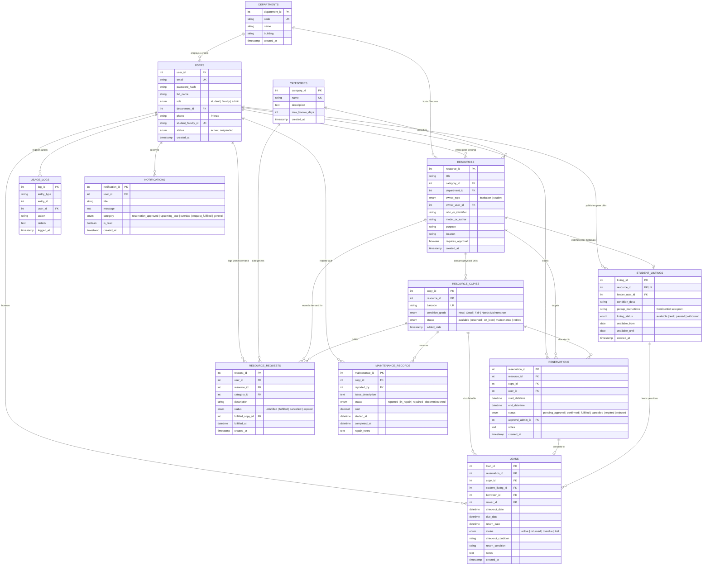

# CRISS - Entity-Relationship (ER) Diagram & Normalization Analysis

## 1. System ER Diagram (Mermaid Relational Architecture)



---

## 2. Relational Normalization Analysis (3NF Decomposition)

The schema was designed strictly to satisfy **Third Normal Form (3NF)**:

### First Normal Form (1NF) Compliance
- Every relation has a defined Primary Key (`INT AUTO_INCREMENT`).
- All columns store atomic, non-repeating scalar attributes.
- Multi-valued attributes (such as multiple physical inventory copies of a single textbook or calculator title) are decomposed into a separate child entity `resource_copies`.

### Second Normal Form (2NF) Compliance
- All non-key attributes are fully functionally dependent on the entire primary key.
- Since synthetic surrogate primary keys (`department_id`, `resource_id`, `copy_id`, `loan_id`) are used, there are no composite primary keys with partial dependencies.

### Third Normal Form (3NF) Compliance
- **Elimination of Transitive Dependencies**:
  - In an un-normalized schema, storing Department building name or Category max borrow days directly inside the `resources` or `users` table would introduce transitive dependencies (`resource_id` $\rightarrow$ `department_id` $\rightarrow$ `building`).
  - By separating `departments` and `categories` into standalone master tables, changes to department buildings or category borrow rules do not cause update anomalies across resources.
- **Physical Copy Separation**:
  - Catalog metadata (title, author, ISBN, purpose) is decoupled from physical instance state (barcode, condition grade, maintenance status). If one copy is damaged, the master resource metadata remains untouched.
- **Student Peer Sharing Normalization**:
  - Student lending metadata (`pickup_instructions`, `condition_desc`, lending availability dates) is decoupled into `student_listings` with a 1-to-1 foreign key to `resources`.
  - Student private contact data (`phone`) resides exclusively in `users`, preventing accidental public exposure or privacy violations.

---

## 3. Concurrency Control & MySQL Locking Mechanism

### Transaction Isolation Level
CRISS leverages MySQL InnoDB's default **`REPEATABLE READ`** isolation level with explicit **Row-Level Exclusive Locking (`SELECT ... FOR UPDATE`)**:

1. **Reservation Hold Concurrency**:
   - When a user submits a reservation request, the system opens an ACID transaction (`START TRANSACTION`).
   - A row-level write lock is placed on eligible copies:
     ```sql
     SELECT rc.copy_id 
     FROM resource_copies rc
     WHERE rc.resource_id = %s
       AND rc.status IN ('available', 'reserved')
       AND rc.copy_id NOT IN (
           SELECT res.copy_id 
           FROM reservations res
           WHERE res.resource_id = %s
             AND res.copy_id IS NOT NULL
             AND res.status IN ('confirmed', 'pending_approval')
             AND NOT (res.end_datetime <= %s OR res.start_datetime >= %s)
       )
     ORDER BY rc.copy_id ASC
     LIMIT 1
     FOR UPDATE;
     ```
   - **Double-Booking Prevention**: The `FOR UPDATE` clause instructs InnoDB to acquire an exclusive row lock (`X lock`) on the candidate copy record and prevents concurrent transactions from inspecting or holding the same unit until the active transaction commits or rolls back.
   - If two students click "Reserve" at the exact same millisecond for the last remaining calculator or laptop, the second transaction waits. Once the first transaction commits, the second transaction sees 0 available copies and safely rolls back with a clear user message, eliminating race conditions.

2. **Trigger-Based Inventory State Synchronization**:
   - `trg_after_loan_insert_update_copy`: Triggered automatically after a row is inserted into `loans`. Synchronizes `resource_copies.status = 'on_loan'` and inserts an audit log entry in `usage_logs`.
   - `trg_after_loan_return_update_copy`: Triggered automatically when `loans.status` transitions to `'returned'`. Safely restores `resource_copies.status = 'available'` (unless flagged for maintenance), ensuring application code and database triggers never conflict.
